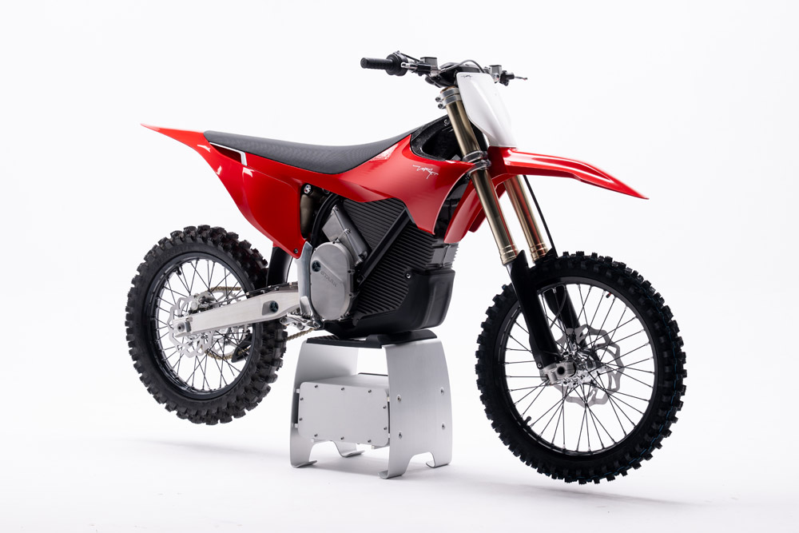
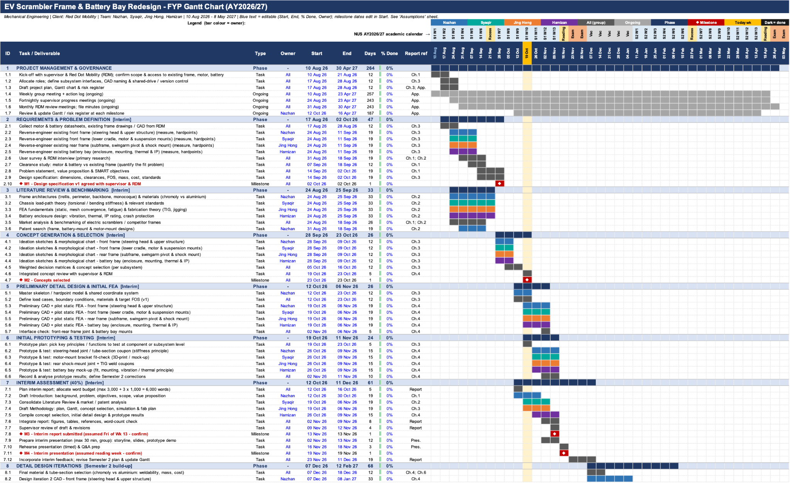
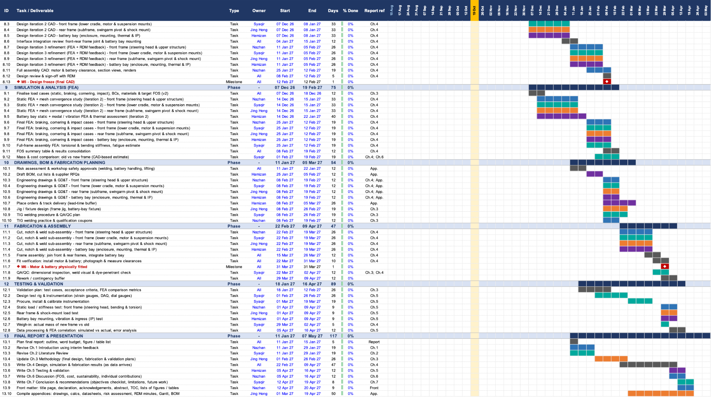
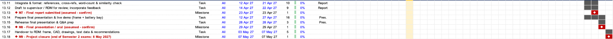
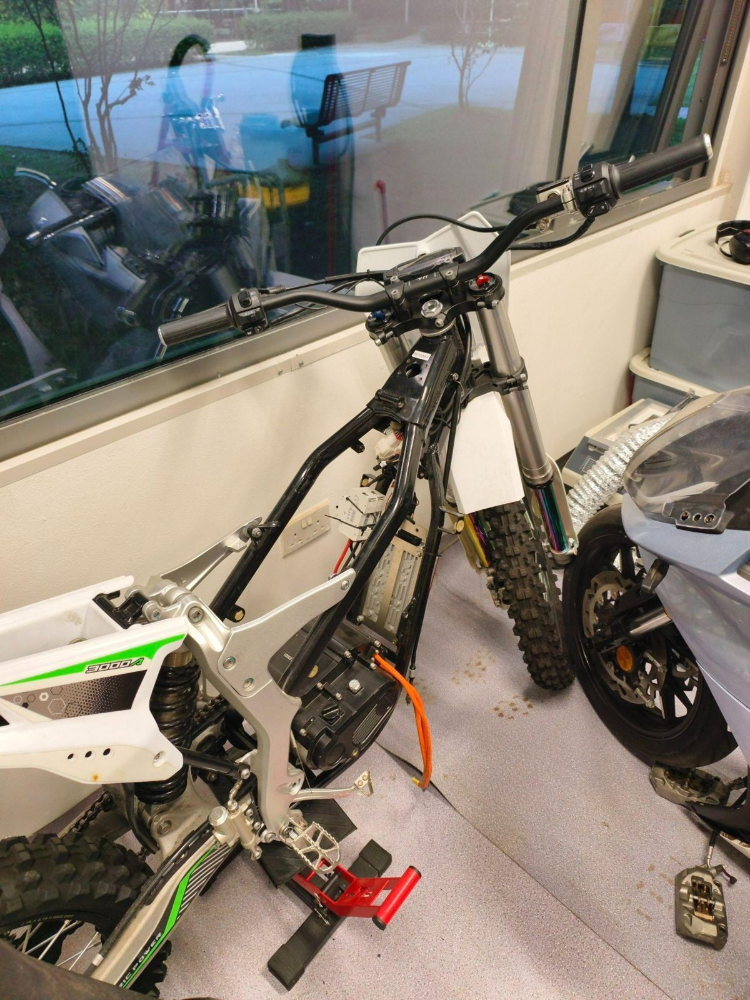
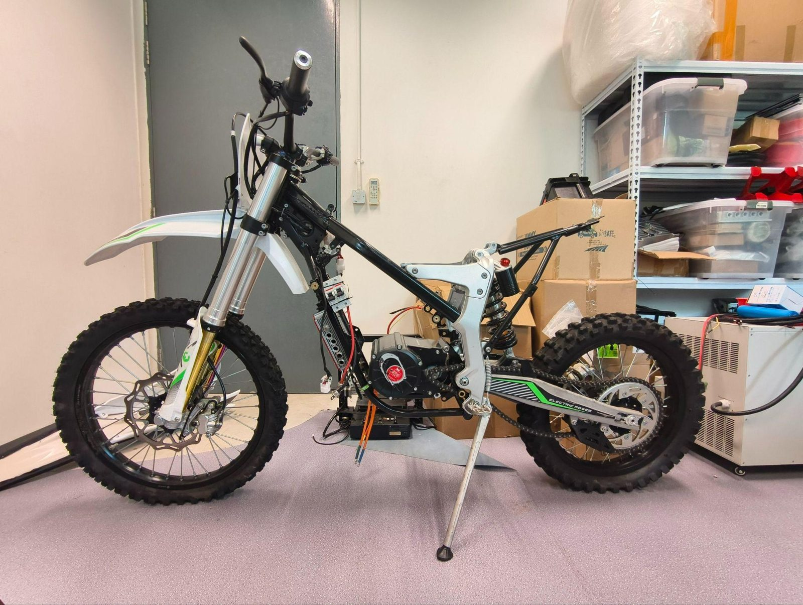
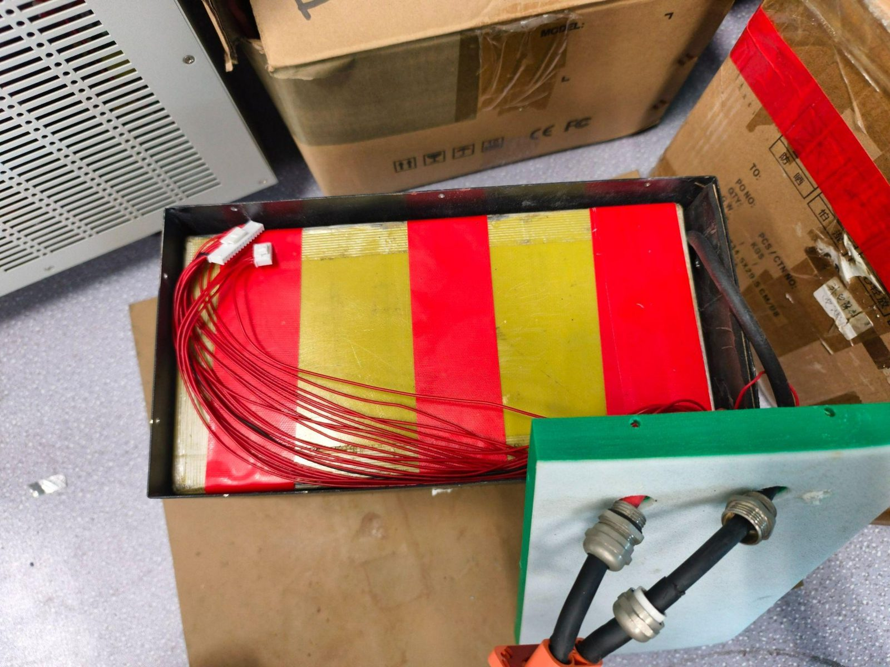
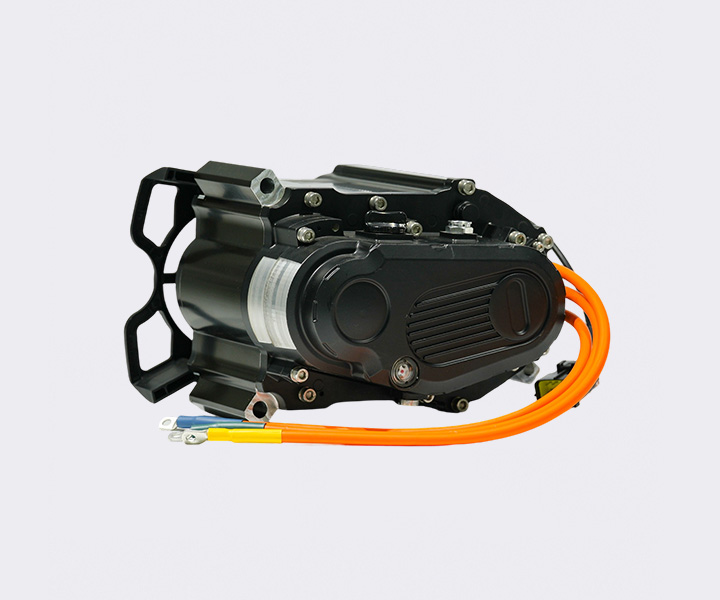

<header class="cover">
  
  
CDE4301 Design and Innovation

  <h1>FTS-401: Red Dot Mobility (Electric Mobility)</h1>
  
AY2026/27 Semester 1

  

    

Chen Jinghong

A0308322N

    

Muhammad Nazhan bin Mohd Nazir

A0308605H

    

Abdul Hamizan Bin Abdul Haris

A0301594H

    

Mohamad Syaqir Bin Mohamad Zahren

A0308618Y

    

Supervisor

Mr Lim Hong Wee

    

Industry partner

Red Dot Mobility Pte Ltd

  

</header>

## Abstract

The electrification of scrambler-style motorcycles is constrained by the need to combine structural durability, low mass and cost-effective manufacture, making integrated frame and battery bay design a key challenge. A design study was undertaken to adapt an existing 400 cc internal combustion scrambler frame for electric propulsion. The aim was to accommodate a battery box, vehicle control unit (VCU) and 25 kW electric motor within a redesigned frame and battery bay, capable of withstanding on-road and off-road riding conditions.

Design targets were defined from the intended application: a complete vehicle mass of 120 kg including tyres, a target retail price of SGD 3,500 and a volume production rate of 10,000 units per year. A 25 kW motor was adopted as the baseline powertrain, and the available packaging envelope of the donor frame was assessed to determine the space available for the battery, VCU and motor. A frame and battery bay layout was then developed, with the load paths, material selection and joining methods chosen to balance structural stiffness, impact resistance, mass and manufacturing cost at the specified production volume.

The proposed frame was evaluated against harsh terrain loading cases, including landing, bump and cornering loads, to confirm that the structure could withstand the demands of mixed road and off-road use without exceeding the mass target. The battery bay was designed to protect the cells from vibration, impact and debris while remaining compatible with series production. It was therefore demonstrated that a lightweight, durable and cost-targeted electric scrambler can be realised within an existing 400 cc frame architecture when the frame, battery bay and component packaging are developed together. The study provides a proof-of-concept basis for the further development of affordable, high-volume electric off-road motorcycles.

The electrification of high-performance motorcycles is constrained by battery mass, limited packaging volume and thermal control requirements, making integrated design a key challenge. An integration study of an electric powertrain for a 400 cc class motorcycle platform was undertaken with Red Dot Mobility. The aim was to identify a motor, inverter, battery configuration and cooling strategy capable of matching conventional 600 cc motorcycle performance within the practical constraints of electrification.

A benchmark study of representative 600 cc motorcycles was used to define a target top speed of 250 km/h. Commercial traction motors and inverters were then screened against power, torque, voltage, mass and package size, from which the EMRAX 228 motor and dti HV-850 inverter were selected. A lithium-ion battery pack was subsequently sized from voltage, power and energy requirements, and a 150s5p Molicel P50B configuration was chosen, providing 540 V nominal, 13.5 kWh and an estimated cell mass of 53.25 kg. Packaging studies showed that ten 15s5p modules could be accommodated within the available chassis envelope.

Battery heat generation was estimated at representative operating points using an 80 kW topspeed thermal case and the WMTC as a comparison basis. CFD simulations were then used to assess air-cooling concepts for the selected pack architecture. Fan-based configurations were predicted to exceed the adopted 45 °C temperature limit, whereas an optimised dual-sided ram air layout reduced the peak cell temperature to 43 °C at 250 km/h. It was therefore demonstrated that a 600 cc class electric motorcycle powertrain can be integrated feasibly when motor selection, battery architecture and cooling geometry are developed together. The study provides a proof-of-concept basis for the further development of high-performance electric motorcycles.

## Acknowledgements

This project on our electric dirt bike was carried out under the Innovation & Design Capstone module at the National University of Singapore in collaboration with Red Dot Mobility.

We would like to thank our Project Supervisor Mr Lim Hong Wee for supporting us throughout the project. His support was instrumental in guiding us to define our direction and execution of our project. We would like to also thank Red Dot Mobility Pte Ltd for allowing us the opportunity to work on an

## 1. Introduction

### 1.1 Report Details

This project involves the redesigning, prototyping and final revision of an electric scrambler bike by Red Dot Mobility. This project also includes in depth analysis with respect to the current design, materials selections and possible changes to enable the final build of the electric scrambler.

### 1.2 Comparison of Scrambler Bikes in Market

For electric we have Stark Varg as a market leader

Segway Xaber 350

For internal combustion engine (ICE) bikes we have KTM, Honda

The reason why there are more electric scramblers is because of the inherent characteristics of electric motors such as its instantaneous throttle response and torque and its simplicity compared to ICE bikes. However it also has its cons which is its weight of battery cell and frame design to handle the instantaneous torque it applies to the bike frame

#### Benchmark Analysis: Stark VARG MX 1.2

<figure class="narrow">
  
  <figcaption>Figure X: Stark VARG MX 1.2</figcaption>
</figure>

##### Selection of the benchmark

The Stark VARG MX 1.2 is used in this report as a benchmark for the proposed design and for a second manufacturer's electric bike. It is a current production electric motorcycle with a detailed public specification, which allows a direct comparison on the same factors. All Stark figures are manufacturer-reported (Stark Future, 2026) and have not been independently verified. Values marked as derived were calculated from those figures for this report.

The VARG is a competition motocross bike. Where the design or the second bike targets a different use, such as road riding or commuting, the comparison shows the gap between that use and the current performance end of the electric motorcycle market.

##### Comparison factors

Six categories are used. Each factor has a fixed unit and formula so that any bike can be assessed the same way. Columns for the second manufacturer's bike and for the proposed design are left empty to be completed.

**Performance**

| Factor              | Stark VARG MX 1.2 |
|---------------------|-------------------|
| Peak power          | 59.7 kW (80 hp)   |
| Rear-wheel torque   | 978 Nm            |
| Electric Motor mass | 9 kg              |
| Motor power density | 6.6 kW/kg         |
| Power-to-weight     | 0.51 kW/kg        |
| Torque-to-weight    | 8.3 Nm/kg         |

**Energy and charging**

| Factor               | Stark VARG MX 1.2                      |
|----------------------|----------------------------------------|
| Battery capacity     | 7.2 kWh                                |
| Pack voltage         | 420 V (motor 360 nominal)              |
| Pack capacity        | About 17.1 Ah (derived)                |
| Energy per bike mass | About 61Wh/kg (derived)                |
| Charger power        | 3.3 kW                                 |
| Cooling              | Air-cooled battery, water-cooled motor |
| Ingress protection   | IP69K (battery)                        |

##### Analysis

The Stark VARG MX 1.2 reports a peak power of 80 hp (59.7 kW) at a total mass of 118 kg, which gives a power-to-weight ratio of about 0.51 kW/kg. Its 7.2 kWh battery gives about 61 Wh per kilogram of whole-vehicle mass. The manufacturer's ride-time tests range from 35 minutes (professional rider, medium-pack track) to 1 hour 31 minutes (beginner, hard-pack track). If the full capacity is usable, these imply average power draws of roughly 4.8 to 12.3 kW.

Compared with [insert RED DOT bike], the proposed design is higher on [factor] because [reason]. *Repeat this sentence for each factor where the difference is large enough to affect the design conclusions.*

##### Applying the factors to another bike

1. Convert every value to SI units. The Stark page mixes hp, ft-lbs, lbs and centimetres.
2. Calculate every derived value from the raw figures using the formulas in the tables, even where the other manufacturer quotes its own.
3. State the test conditions for ride time and range. These depend on rider, terrain and speed, so mark them as not directly comparable where conditions differ.
4. Write "not published" where a figure is unavailable, since missing data is itself a finding.
5. Record the source type for each value: manufacturer claim, independent test or own measurement.

##### Limitations of the Stark data

- Pack capacity in Ah, energy per bike mass, average power draw and the countershaft-to-wheel reduction ratio (about 3.6 to 1, from 978 Nm and 275 Nm) are derived estimates. Stark does not publish battery mass or usable capacity.
- The frame is described as high strength steel in the specification table and as chromoly steel in the text.
- Charge time is given as 2 hours in the headline figures and 3.5 hours at 120 V in the specification table. The charger section also states a full charge in under 2 hours on a 220 V supply, with a 110 V adapter sold separately.
- The running cost comparison of US$608 per 100 hours is Stark's own calculation and should be treated as a marketing estimate.
- The VARG is built for motocross, so some factors such as seat height and ground clearance reflect off-road use.

### 1.4 Project Scope

<figure>
  
  
  
  <figcaption>EV Scrambler Frame &amp; Battery Bay Redesign: FYP Gantt Chart (AY2026/27). Open an image in a new tab to zoom in.</figcaption>
</figure>

## 2. Company Background

### 2.1 Company Goals

The goal of Red Dot Mobility is that they want us to modify an existing bike that they are in the prototyping phase. They want to reduce its curb weight to be competitive with existing bikes. They also need us to mount the motor and battery. They do not want to modify simple/ common (idk how describe) parts such as the rear swingarm and also other generic parts such as the wheels, tyre, rear suspension, front fork which are common source by other manufacturers. For this project we will mainly focus on refinement of the front frame, rear frame, subframe, silver supporting frame, battery and motor.

## 3. Current Design of Dirtbike (Red Dot Mobility)

#### Red Dot Mobility Electric Scrambler

The Red Dot Mobility Electric Scrambler is the product of the project's collaborating company. All figures below are taken from the manufacturer's datasheet.

**Performance**

| Factor              | Red Dot Mobility Electric Scrambler           |
|---------------------|-----------------------------------------------|
| Peak power          | 25 kW (rated power 5 kW)                      |
| Rear-wheel torque   | 1,200 Nm (datasheet states 1200N, assumed Nm) |
| Electric motor mass | Not published                                 |
| Motor power density | Not published                                 |
| Power-to-weight     | 0.21 kW/kg (derived, 118 kg total mass)       |
| Torque-to-weight    | 10.2 Nm/kg (derived)                          |

**Energy and charging**

| Factor               | Red Dot Mobility Electric Scrambler    |
|----------------------|----------------------------------------|
| Battery capacity     | 4.32 kWh (derived, 72 V x 60 Ah)       |
| Pack voltage         | 72 V (rated)                           |
| Pack capacity        | 60 Ah (rated)                          |
| Energy per bike mass | About 37 Wh/kg (derived)               |
| Charger power        | Not published (charging time 3 to 4 h) |
| Cooling              | Not published                          |
| Ingress protection   | Not published                          |

**Specifications**

The Red Dot scrambler uses a 72 V, 60 Ah lithium-ion pack with a mid-drive BLDC motor and 4-speed gearbox, and has a total mass of 118 kg, At that mass, its 25 kW peak power gives 0.21 kW/kg, against 0.51 kW/kg for the Stark, and its 4.32 kWh pack gives about 37 Wh/kg, against about 61 Wh/kg. Its wheel torque is higher (10.2 against 8.3 Nm/kg), but this is a peak figure and depends on the gear selected.

### 3.1 Front Frame

<figure class="narrow">
  
</figure>

For the current dirtbike that was provided to us by

### 3.2 Rear Frame

<figure class="narrow">
  
</figure>

test

### 3.3 Battery

<figure class="narrow">
  
</figure>

### 3.4 Electric Motor Mount

#### Motor Specifications: YM PMSM Mid Motor (YM MOTOR)

The propulsion unit considered for the electric scrambler motorcycle is the YM PMSM (permanent magnet synchronous motor) mid motor with an integrated reduction gearbox, manufactured by Wuxi Yuma Power Technology Co., Ltd. (YMMOTOR). It is an air-cooled, mid-mounted unit with a rated output of 10 kW, designed to run from a 48–72 V battery system. This section presents its manufacturer-stated specifications and discusses their relevance to the scrambler application.

##### Manufacturer Specifications

Specifications of the YM PMSM mid motor with reduction gearbox.

**Category 1: Performance**

| Parameter        | Value            |
|------------------|------------------|
| Rated power      | 10,000 W (10 kW) |
| Peak power       | 25kW             |
| Rated torque     | 19.1 N·m         |
| Rated speed      | 5,000 rpm        |
| Rated efficiency | ≥ 90%            |

Table 1: YM Motor Performance

**Category 2: Electrical**

| Parameter       | Value   |
|-----------------|---------|
| Rated voltage   | 48–72 V |
| Position sensor | Encoder |

Table 2: YM Motor Electrical

**Category 3: Thermal, Durability and Configuration**

| Group                  | Parameter          | Value                                     |
|------------------------|--------------------|-------------------------------------------|
| Thermal and durability | Cooling system     | Air cooling                               |
| Thermal and durability | Protection level   | IP67                                      |
| Thermal and durability | Temperature sensor | KTY84-130                                 |
| Configuration          | Motor type         | PMSM, mid-mounted, with reduction gearbox |

Table 3: YM Motor Others

<figure class="narrow">
  
  <figcaption>Figure 1: YM PMSM mid motor with reduction gearbox.</figcaption>
</figure>

##### Performance

The motor is rated at 10 kW continuous output at 5,000 rpm, producing 19.1 N·m of rated torque. For a scrambler, which needs strong low-speed torque for climbing and loose surfaces, the useful wheel torque depends on the reduction gearbox and the final drive (chain and sprockets). The motor's torque is multiplied by the total reduction ratio, so the achievable tractive force at the rear wheel is [calculate once the gear ratios are known].

The rated efficiency of at least 90% is typical of PMSM machines and is a major advantage over internal combustion engines. High efficiency reduces energy lost as heat and directly improves the achievable range from a given battery capacity. This figure applies at the rated operating point, and efficiency will be lower at light loads.

##### Electrical Characteristics

The 48–72 V rated voltage range allows the motor to be used with several battery pack configurations. For a motor at this power level, the choice of voltage strongly affects the current drawn. Using the rated power and the minimum efficiency, the input power is approximately:

Pin = Pout / η = 10,000 / 0.90 ≈ 11.1 kW

The corresponding DC current is:

- At 72 V: I ≈ 11,111 / 72 ≈ **154 A**
- At 48 V: I ≈ 11,111 / 48 ≈ **231 A**

These are approximate values that ignore controller losses and battery voltage sag. They show that a 72 V system draws about one third less current than a 48 V system for the same power, which allows lighter cabling, lower resistive losses, and a smaller, cheaper controller. For this reason, [72 V is the preferred system voltage for this project].

The motor uses an encoder for rotor position feedback. This allows accurate field-oriented control and smooth torque delivery at very low speeds, which is valuable for technical off-road riding where fine throttle control is needed.

##### Thermal Management and Durability

The motor is air cooled, which keeps the design simpler, lighter and cheaper than a liquid-cooled system, with no pump, radiator or coolant lines to be damaged off-road. The trade-off is a lower capacity for sustained high-load operation, so continuous hill climbing in hot conditions may force the controller to reduce power.

A KTY84-130 temperature sensor is fitted. This is a silicon temperature sensor commonly used in motor windings, and it lets the controller monitor winding temperature and reduce output before overheating occurs.

The IP67 rating means the motor is fully protected against dust and can withstand temporary immersion in water. This suits a scrambler, which is exposed to mud, dust, rain and shallow water crossings.

##### Mid-Mounted Configuration

A mid-mounted motor drives the rear wheel through a chain or belt, rather than being built into the wheel hub. This is attractive for a scrambler for the following reasons:

- It keeps unsprung mass low, which improves suspension response and traction on rough terrain.
- It places the motor mass low and central in the frame, which improves weight distribution and handling.
- The final drive ratio can be changed by swapping sprockets, so acceleration and top speed can be tuned to the application.

These advantages come with the added complexity and maintenance of a chain or belt drive.

##### Consistency Check of Rated Values

The manufacturer's figures are internally consistent. Rated torque follows from rated power and speed:

ω = 5,000 × 2π / 60 ≈ 523.6 rad/s T = P / ω = 10,000 / 523.6 ≈ 19.1 N·m

This matches the stated rated torque of 19.1 N·m, which suggests the figure is quoted at the motor output at rated speed. It is not stated whether this value is measured before or after the reduction gearbox. This should be confirmed with the supplier.

##### Data Not Available and Limitations

The supplier's webpage does not state the following values, which are needed for a full vehicle design analysis:

**Specifications to be confirmed with the supplier**

| Parameter               | Status           |
|-------------------------|------------------|
| Peak power              | 25kW             |
| Peak torque             | 48Nm             |
| Gearbox reduction ratio | Need more data   |
| Maximum speed           | Need more data   |
| Rated and peak current  | 154A, 386A @ 72V |
| Mass and dimensions     | Need more data   |
| Insulation class        | Need more data   |

In addition, all values in Table 1, 2 and 3 are manufacturer claims and have not been independently verified by testing. The ratings are continuous (rated) values and should not be read as peak performance. Where assumptions are made in the vehicle calculations, they are stated explicitly in the relevant sections.

##### Suitability

Based on the published specifications, the motor is suitable for the scrambler because of its high rated power, high efficiency, wide voltage range, accurate encoder feedback and IP67 protection. The main points to verify are the peak torque and the gear ratio (to confirm acceleration and climbing ability), the weight, and the thermal performance under sustained load, given that cooling is by air only.

## 4. Improvements

### 4.1 Weight Reduction

Test

### 4.2 Simplification / Reduction of Existing Parts

Test

### 4.3 Mounting of Battery and Motor

Test

## 5. Improvements

### 5.1 CAD

Test

### 5.2 CFD and Static 2D Testing

Test

### 5.3 Mounting of Battery and Motor

Test
